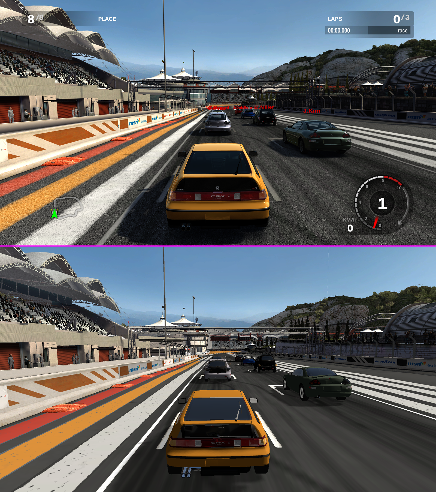

# FM3-Godot

Forza Motorsport 3, on the [FM3 ReGPU recomp](https://github.com/braaap-stututu/FM3-ReGPU), with its rendering rebuilt in
**Godot** for better performance and more flexibility (triple screen at about twice the recomp's frame rate in the first
measurements). The general render-offload framework lives upstream in
**[GodotRenderOffloadForRecomps](https://github.com/braaap-stututu/GodotRenderOffloadForRecomps)**; this repository is
the FM3 application of it (git remote `upstream`).

**Start with [`HANDOFF.md`](HANDOFF.md)**: status, folder layout, how to rebuild and run, issues and fixes, open items.
Details: [`M1.md`](M1.md) (the work log), [`FM3-FORMATS.md`](FM3-FORMATS.md) (FM3's file formats as decoded here:
track models, `.bix`/`.stx` textures and lightmap atlases, `.pvs` placements, `.carbin` cars, environment cubes),
[`ARCHITECTURE.md`](ARCHITECTURE.md) (the overall plan).

## What is here

- `tools/fm3_*.py`: readers for FM3's files (`fm3_track.py`, `fm3_tex.py`, `fm3_pvs.py`, `fm3_car.py`, `fm3_assets.py`),
  the track/shader-family exporter (`fm3_track_export.py`, `fm3_families.py`, `fm3_shaders.py`, `fm3_track_texmap.py`),
  `fm3unzip` (FM3's LZX zips), `rebuild_ladera.ps1` (the whole pipeline in one command).
- `tools/fir_*.py`: the Xbox 360 frame-capture tooling (shared with upstream).
- `godot/viewer/`: the scene viewer (`world_view.gd`, fly mode, triple screen, benchmarks) and FM3's shaders (baked
  lightmaps, multi-texture families, glass with the game's environment cube).
- `profiles/fm3/`: FM3's material rules.
- `m0/`, `m1/`, `gamelogic/`: measurements and comparison images.

**No game data is in this repository.** You need your own copy of the game and the recomp; generated scenes go to the
git-ignored `out/`. Requirements: Python 3 + numpy, Godot 4.7.2.
